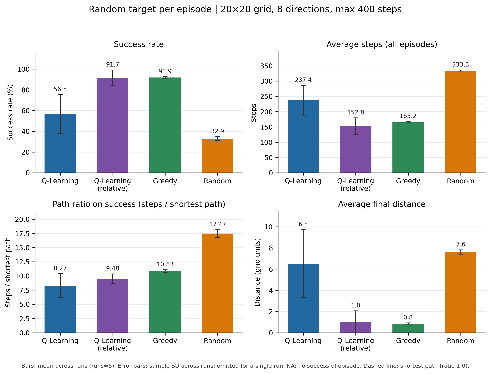

# Greedy Search 추가 및 상대 방향 행동 Q-Learning 실험 정리

> 작성일: 2026-11-06 · 브랜치: `feature/greedy-search` (아직 커밋 전, 검토 후 PR 예정)

## 요약

- 비교 알고리즘이 Random Search뿐이라 근거가 약해서 **Greedy Search**를 추가했다.
- 그런데 Greedy(91.9%)가 기존 Q-Learning(56.5%)보다 훨씬 좋게 나왔다.
- 원인을 분석해 Q-Learning의 **행동을 '절대 방향'에서 '상대 방향(진행 방향 기준 회전)'으로 바꾸는 옵션**을 추가했다.
- 그 결과 Q-Learning 성공률이 **56.5% → 91.7%**로 올라 Greedy와 비슷해졌고, **이동 횟수와 경로 비율은 Greedy보다 낮았다**.
- 남은 과제: Run 간 편차가 크다(표준편차 Q 7.5%, Greedy 0.7%). 논문 방향은 팀에서 정해야 한다.

---

## 1. 실험 조건

| 항목 | 설정 |
|---|---|
| Grid | 20 × 20, 시작점 (0, 0) |
| 이동 | 8방향 (대각선 포함) |
| Target | Random (에피소드마다 무작위, 시작점에서 8방향 거리 5 이상) |
| 최대 이동 | 400 Step |
| Q-Learning 학습 | 1,000 에피소드 / Run (보조 실험: 5,000) |
| 평가 | 1,000 에피소드 / 알고리즘 / Run |
| 반복 | 5 Run (서로 다른 Seed) |
| RSSI 잡음 | Gaussian σ = 2 dB (기존 설정) |

- 같은 Run의 같은 평가 에피소드에서는 **모든 알고리즘이 같은 Target 위치와 같은 잡음 Seed**를 받는다.
- Seed 규칙은 기존 `compare_algorithms`와 같다. 기존 Q-Learning과 Random의 평가 결과가 기존 코드와 완전히 같다는 것을 테스트로 확인했다.

## 2. 비교 알고리즘

| 알고리즘 | 동작 | 학습 |
|---|---|---|
| Q-Learning (절대) | 기존 방식. 상태 → 8방향(↑↓←→↖↗↙↘) 중 하나 선택 | 필요 |
| **Q-Learning (상대)** | 새로 추가. 상태 → {직진, 45°, 90°, 135° 회전, 되돌아가기} 중 하나 선택 | 필요 |
| **Greedy** | 새로 추가. RSSI가 충분히 오르면 방향 유지, 아니면 다른 방향으로 무작위 전환 | 없음 |
| Random | 8방향 중 무작위 | 없음 |

### 2.1 Greedy 규칙

1. 에피소드를 시작할 때 8방향 중 하나를 무작위로 골라 초기 방향으로 삼는다.
2. 한 칸 이동한 뒤 ΔRSSI = 현재 RSSI − 직전 RSSI를 계산한다.
3. ΔRSSI > τ(2 dB)이면 방향을 유지한다. 이 기준은 Q-Learning 상태의 '증가'와 같다.
4. 변화가 없거나 감소했거나 경계에 막혔으면, 현재 방향을 제외한 7방향 중 하나를 무작위로 고른다.

공정성을 위해 다음 정보는 쓰지 않는다.
- Target 좌표와 거리, 가 보지 않은 칸의 RSSI는 사용하지 않는다.
- RSSI는 시작할 때 1회, 이동할 때마다 1회만 관측한다.

평활화와 방문 기록은 적용하지 않았다(최소 설정).

### 2.2 상대 방향 행동 (Q-Learning)

- 에이전트가 '현재 진행 방향(heading)'을 기억하고, 고른 상대 행동을 절대 방향으로 바꿔 환경에 전달한다.
- **환경(`environment.py`)은 수정하지 않았다.** Wrapper가 변환을 담당한다.
- 45°·90°·135° 회전의 좌/우는 무작위(1/2 확률)로 정한다. 초기 heading도 무작위다.
- 상태: (RSSI 수준 5, 추세 3, 이전 상대 행동 5 + 초기 1) → 최대 90개, 행동 5개
  - 절대 방향은 최대 135개(5×3×9), 행동 8개

## 3. 왜 기존 Q-Learning(절대 방향)이 Greedy보다 낮았나

**1. 위치를 구분할 수 없다 (상태 중복, state aliasing).**
- 상태 (RSSI 수준, 추세, 이전 행동)에는 위치 정보가 없다.
- 그래서 신호원이 오른쪽에 있는 위치와 왼쪽에 있는 위치가 같은 상태로 보일 수 있다.
- Q-table은 상태마다 행동을 하나만 저장하므로, 둘 중 한 곳에서는 틀린 행동을 하게 된다.

**2. 같은 상태에서 항상 같은 행동을 한다 → 루프에 빠진다.**
- 평가 때는 Q값이 최대인 행동만 고르는 결정적 정책이다.
- 그래서 `(수준2, 유지, RIGHT) → DOWN → (수준2, 유지, DOWN) → RIGHT → …`처럼 같은 동작을 반복한다.
- 실패한 에피소드에서 400 Step 동안 방문한 칸: **Q-Learning 60칸**, Greedy 155칸, Random 144칸 (축소 실험 기준)

**3. 절대 방향 정책은 신호원 방향에 묶인다.**
- "RSSI가 늘면 ↘로 가라"는 신호원이 오른쪽 아래에 있을 때만 맞다.
- Target이 매번 바뀌는 조건에서는 이런 습관이 통하지 않는다.

**Greedy가 잘하는 이유**: 위치 정보가 없는 것은 Greedy도 같다. 하지만 판단이 틀리면 무작위로 다른 방향을 시도하기 때문에 같은 실수를 반복하지 않는다.

**확인한 사항**
- Greedy에 실제 RSSI 대신 무작위 값을 넣으면 성공률이 92.7%에서 36.3%로 떨어져 Random과 같아진다. 즉 Greedy의 성능은 **실제로 RSSI를 활용한 결과**다(버그 아님).
- 절대 방향 Q-Learning에 평가 시 무작위성(ε = 0.05~0.3)만 넣었을 때는 성공률이 최대 13%p 정도만 올랐다.
- 반면 상대 방향으로 바꾸자 35%p 올랐다. 따라서 루프를 푸는 것보다 **방향과 무관한 규칙을 학습할 수 있게 된 것**의 효과가 더 큰 것으로 보인다.

## 4. 본 실험 결과

### 4.1 학습 1,000회 (5 Run 평균 ± 표준편차)

| | Q (절대) | **Q (상대)** | Greedy | Random |
|---|---|---|---|---|
| 성공률 | 56.5 ± 18.7% | **91.7 ± 7.5%** | 91.9 ± 0.7% | 32.9 ± 2.0% |
| 평균 Step (실패 포함) | 237.4 | **152.8** | 165.2 | 333.3 |
| Path Ratio (성공 시) | 8.27* | **9.48** | 10.83 | 17.47 |
| 최종 거리 | 6.51 | 1.02 | **0.83** | 7.62 |

\* 절대 방향 Q-Learning의 Path Ratio는 성공률이 56.5%라, 상대적으로 쉬운(가까운) 에피소드 위주로 계산된 값이다.

Run별 성공률 (같은 Target·잡음 조건):

| Run | Q (절대) | Q (상대) | Greedy | Random |
|---|---|---|---|---|
| 1 | 29.6% | **94.1%** | 92.6% | 34.4% |
| 2 | 63.7% | 78.7% | **92.0%** | 34.6% |
| 3 | 48.3% | **95.0%** | 90.7% | 32.3% |
| 4 | 79.6% | **93.1%** | 92.0% | 29.8% |
| 5 | 61.3% | **97.6%** | 92.0% | 33.3% |

→ 상대 방향 Q-Learning이 **5 Run 중 4번 Greedy보다 높았다**. 평균이 비슷한 것은 Run 2(78.7%) 때문이다.



### 4.2 학습 5,000회 (보조 실험)

| | 학습 1,000회 | 학습 5,000회 |
|---|---|---|
| Q (상대) 성공률 | 91.7 ± 7.5% | 91.5 ± 7.4% |
| Q (절대) 성공률 | 56.5 ± 18.7% | 62.0 ± 14.2% |
| Q (상대) 평균 Step | 152.8 | 150.5 |

- 학습량을 5배로 늘려도 상대 방향 Q-Learning의 평균과 편차는 그대로다. **1,000회에서 이미 수렴**했다고 볼 수 있다.
- Run 간 편차는 학습 부족 때문이 아니라, **Run마다 서로 다른 정책으로 수렴**하기 때문으로 보인다.

### 4.3 Greedy와 다르게 학습된 점

학습된 Q-table(상대 방향)을 보면 다음과 같은 패턴이 나타났다.
- **신호가 강한 구간(수준 3~4)에서 RSSI가 감소하면 → 되돌아가기 또는 135° 회전**
  - Greedy는 이 경우 무작위로 방향을 바꾼다.
- 신호가 증가하면 → 주로 직진 또는 45° 회전
- 신호가 약한 구간(수준 1) → 뚜렷한 규칙 없음
  - 먼 거리에서는 한 칸 이동으로 생기는 실제 RSSI 변화(약 0.9 dB)가 τ(2 dB)보다 작아서, 추세가 사실상 잡음으로 결정된다.

## 5. 논문 관련

### 5.1 쓸 수 있는 메시지 (현재 결과 기준)

> 단순히 Q-Learning을 적용한 경우(절대 방향 행동), 상태가 위치를 구분하지 못하는 부분 관측 문제로 순환 이동이 발생하여 Greedy보다 성공률이 크게 낮았다(56.5% vs 91.9%). 행동을 진행 방향 기준의 회전으로 재정의하자 성공률이 91.7%로 향상되어 Greedy와 비슷한 수준이 되었으며, 평균 이동 횟수(152.8 vs 165.2)와 경로 비율(9.48 vs 10.83)은 더 낮았다. 다만 실행 간 편차가 커 학습 안정성 개선이 필요하다.

### 5.2 기존 초안에서 고쳐야 할 부분

- **2장 행동 정의**: 4방향 → 8방향 이동. 상대 방향을 채택한다면 "진행 방향 기준 5가지 회전 행동" 설명을 추가해야 한다.
- **2장 상태 수**: "최대 75개 상태, 4개 행동"
  - 절대 방향: 135개 상태, 8개 행동
  - 상대 방향: 90개 상태, 5개 행동
- **3장 실험 조건**: 20×20 / 최대 400 Step / 학습 1,000 / 평가 1,000 / 5 Run, 비교 대상에 Greedy 추가
- **초록·결론**: Greedy 결과를 함께 적어야 한다. Random 대비 우위만 쓰면 결과와 맞지 않는다.

### 5.3 피해야 할 것

- 좋게 나온 Run만 골라서 보고하기
- Greedy는 그대로 두고 Q-Learning만 여러 번 튜닝하기. 바꿨다면 논문에 밝혀야 한다.

## 6. 팀에서 정해야 할 것

1. **Q-Learning 행동 방식**: 상대 방향을 본 방법으로 채택할지, 절대 방향과 둘 다 보고할지
2. **추가 실험 여부** (선택)
   - 잡음 강건성 (σ = 2, 4, 6 dB): Greedy는 τ = 2 dB로 고정된 규칙이라 잡음이 커지면 성능이 떨어질 가능성이 있다. Q-Learning의 장점을 보여 줄 수 있는 후보다(아직 확인 안 됨).
   - Run 간 편차 줄이기: 학습률 α 조정 등. 단, Q-Learning만 튜닝하는 것이 된다.
3. **Split 조건**도 같은 4개 알고리즘으로 돌릴지 (`--target-mode split`)

---

## 부록 A. 코드 변경 사항

새 파일:

| 파일 | 역할 |
|---|---|
| `src/greedy_agent.py` | Greedy 방향 선택 규칙 |
| `src/greedy_experiment.py` | Greedy 단독 실행 (`random_experiment.py`와 같은 구조) |
| `src/relative_actions.py` | 상대 행동 → 절대 방향 변환 Wrapper (`RelativeActionEnv`) |
| `src/compare_three_algorithms.py` | 알고리즘 비교 실험, CSV·경로 JSON 저장 |
| `src/plot_three_algorithms.py` | 성능 비교 그래프, 최적·대표 경로 그림 |
| `tests/test_greedy_agent.py`, `tests/test_compare_three_algorithms.py`, `tests/test_relative_actions.py` | 테스트 57개 |

수정한 파일 (기본 동작은 그대로):

| 파일 | 변경 |
|---|---|
| `src/compare_algorithms.py` | `train_q_learning_agent`에 `action_mode` 인자 추가 (기본 `"absolute"` = 기존과 동일) |
| `src/experiment.py` | `build_agent`에 `num_actions` 인자 추가 (기본값 = 기존과 동일) |

전체 테스트: **289개 통과** (기존 232개 + 신규 57개)

## 부록 B. 실행 방법

```bash
# 계획서 조건 (3개 알고리즘: Q-Learning 절대, Greedy, Random)
python -m src.compare_three_algorithms

# 상대 방향 Q-Learning 포함 4개 비교 (이번 본 실험)
python -m src.compare_three_algorithms --algorithms q_learning q_learning_relative greedy random

# 조건 변경 예시
python -m src.compare_three_algorithms --target-mode split --runs 5 --train-episodes 1000 --eval-episodes 1000

# 저장된 결과로 그림만 다시 그리기
python -m src.plot_three_algorithms --input-dir results/three_algorithms_random_20x20_400steps_1000ep
```

결과 폴더마다 저장되는 파일:
- `three_algorithm_episodes.csv`: 에피소드별 결과
- `three_algorithm_runs.csv`: Run·알고리즘별 지표
- `three_algorithm_summary.csv`: 평균 ± 표준편차
- `three_algorithm_paths.json`: 최적 경로와 대표 경로의 실제 좌표
- `three_algorithm_comparison.png/.pdf`, `three_algorithm_paths.png/.pdf`

본 실험 결과:
- `results/three_algorithms_random_20x20_400steps_1000ep/`
- `results/three_algorithms_random_20x20_400steps_5000ep/`
